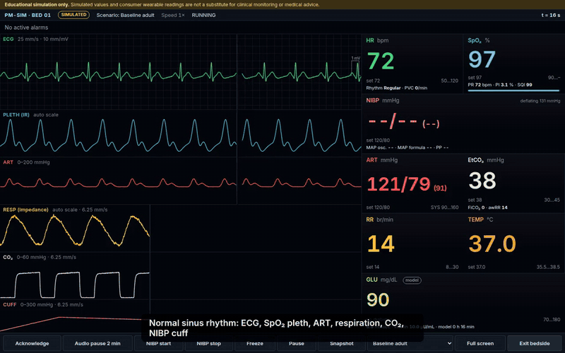
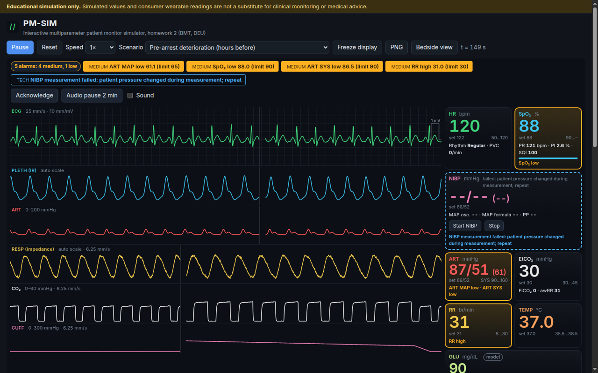
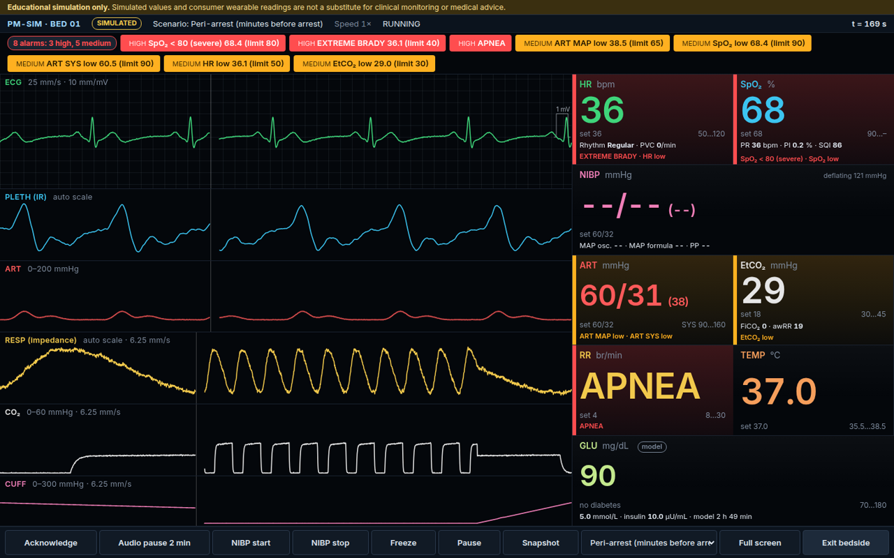
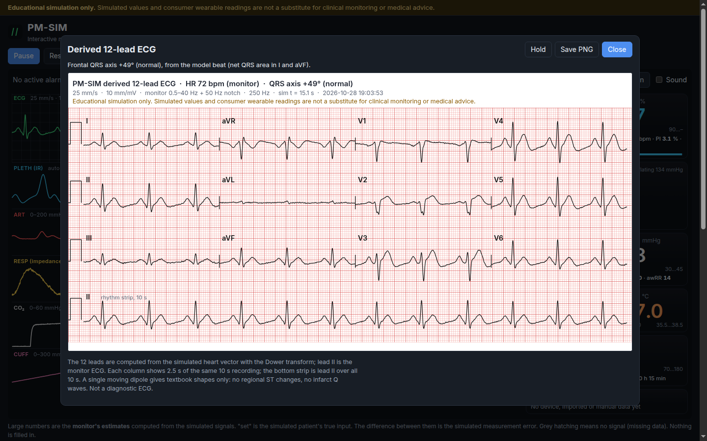
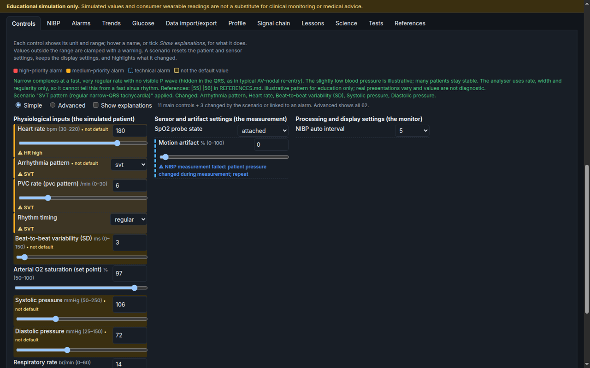
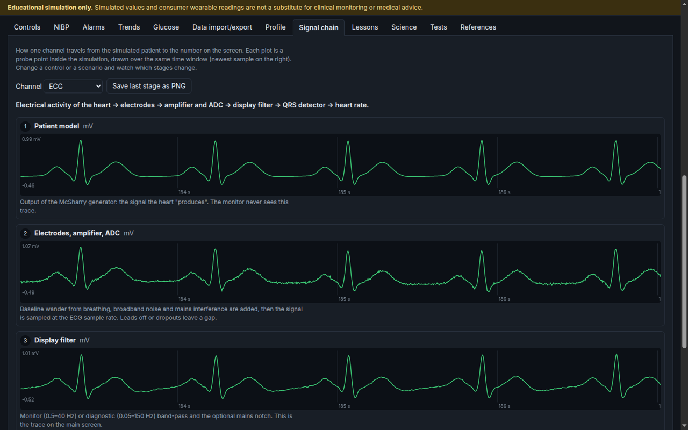
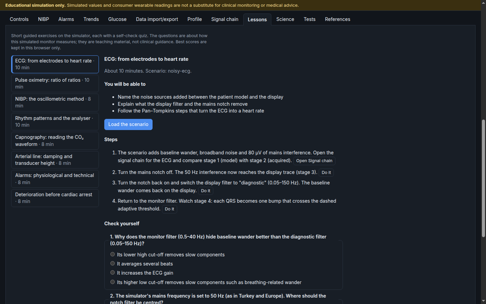
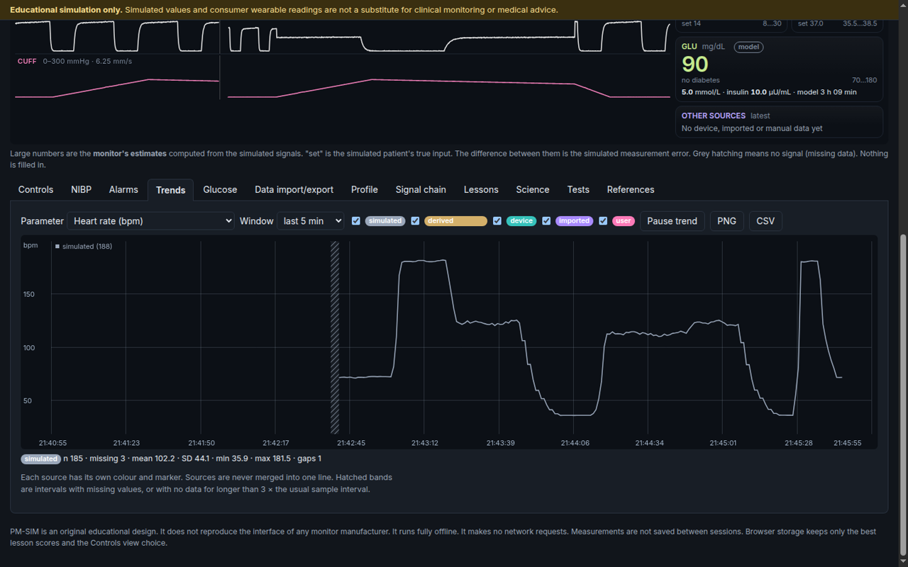
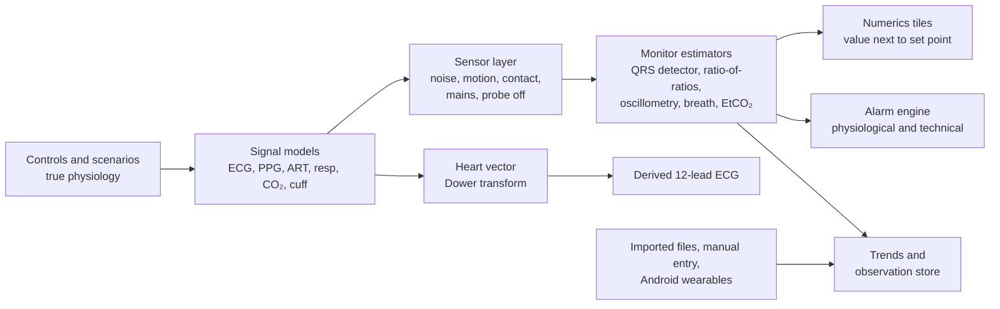

<div align="center">

# PM-SIM

### An interactive bedside patient-monitor simulator for teaching

Simulated physiology → simulated sensors → the monitor's own estimators → numbers, alarms and trends.
Every number on the screen sits next to the value that generated it, so measurement error is visible.

[](https://hafij-bge.github.io/patient-monitoring/)
[](https://github.com/Hafij-BGE/patient-monitoring/releases/latest)
[](https://github.com/Hafij-BGE/patient-monitoring/actions/workflows/pages.yml)


**[Open the live demo](https://hafij-bge.github.io/patient-monitoring/)** ·
**[Download v1.3.1](https://github.com/Hafij-BGE/patient-monitoring/releases/tag/v1.3.1)** ·
**[Watch the video](docs/media/demo.mp4)** ·
**[Technical report](TECHNICAL_REPORT.md)**

</div>

> [!WARNING]
> **Educational simulation only. Simulated values and consumer wearable readings are not a substitute for clinical monitoring or medical advice.**

<div align="center">
  
  <sub>Recorded from the app. Full-quality video (43 s, 1280 × 800, H.264): <a href="docs/media/demo.mp4">docs/media/demo.mp4</a></sub>
</div>

---

## Contents

- [About](#about)
- [Screenshots](#screenshots)
- [What it simulates](#what-it-simulates)
- [Features](#features)
- [Derived 12-lead ECG](#derived-12-lead-ecg)
- [Get it](#get-it)
- [Tests](#tests)
- [How it works](#how-it-works)
- [Data provenance](#data-provenance)
- [Known limitations](#known-limitations)
- [Privacy and safety](#privacy-and-safety)
- [Documents](#documents)
- [Credits](#credits)

## About

PM-SIM is Homework 2, *Interactive Medical Device Simulator*, for the Biomedical Technologies master's programme at Dokuz Eylül University. The assigned device is a multiparameter bedside **patient monitor**. Author: Md. Hafijur Rahman. The app was built with Vibe Coding; the prompts are in [`VIBE_CODING_PROMPT.md`](VIBE_CODING_PROMPT.md).

The design goal is scientific correctness and meaningful interaction, not decoration. A real monitor does not *know* the patient's heart rate: it estimates it from a noisy signal. PM-SIM shows that whole chain. You set the "true" physiology, choose how the sensors behave (motion, poor contact, mains noise, probe off), and watch the monitor's estimators get it right or wrong.

## Screenshots

<table>
  <tr>
    <td width="50%"><br><sub><b>Monitor.</b> Six sweeping waveforms and numerics tiles, each with its set point and source badge. Scenario: deterioration before arrest.</sub></td>
    <td width="50%"><br><sub><b>Bedside view</b> (key <kbd>B</kbd>). Large numerics, alarm strip and softkeys. Scenario: peri-arrest, high-priority alarms.</sub></td>
  </tr>
  <tr>
    <td><br><sub><b>Derived 12-lead ECG.</b> Click the ECG waveform. 3 × 4 layout plus a 10 s lead II rhythm strip, 25 mm/s, 10 mm/mV.</sub></td>
    <td><br><sub><b>Controls.</b> Simple view shows the main controls plus any the scenario changed; Advanced shows all 62.</sub></td>
  </tr>
  <tr>
    <td><br><sub><b>Signal chain.</b> Each processing stage as a live plot, from the clean model signal to the detector output.</sub></td>
    <td><br><sub><b>Lessons.</b> Eight guided lessons with buttons that set the controls, and a graded quiz.</sub></td>
  </tr>
  <tr>
    <td colspan="2"><br><sub><b>Trends.</b> Any parameter from any source over a chosen window. Gaps are drawn as breaks, never as zeros.</sub></td>
  </tr>
</table>

## What it simulates

| Channel | Simulated signal | Monitor estimator in the app |
|---|---|---|
| **ECG** | Dynamical ECG model (McSharry type) with teaching arrhythmias: AF, PVCs, VT, VF, asystole, SVT | Simplified Pan–Tompkins QRS detector with a rhythm classifier and PVC count |
| **12-lead ECG** | Derived from the same beat as a moving heart vector (Dower transform) | Frontal QRS axis from leads I and aVF |
| **SpO₂** | Red and infrared photoplethysmogram | Ratio-of-ratios R → SpO₂, signal-quality index, perfusion index |
| **Arterial line (ART)** | Invasive pressure waveform, 0–200 mmHg, with damping and transducer height error | Beat-by-beat SYS / DIA / MAP |
| **Respiration** | Thoracic impedance | Breath detector, RR, apnea |
| **Capnography (CO₂)** | Capnogram with rebreathing and bronchospasm shapes | EtCO₂, FiCO₂, airway RR |
| **NIBP** | Oscillometric cuff deflation | Envelope method: MAP at maximum oscillation, SYS / DIA by fixed ratios |
| **Temperature** | Core temperature | Direct reading |
| **Glucose and insulin** | Bergman minimal model with meal absorption and subcutaneous insulin (Hovorka) | Model value with a "model" badge, projection 2–4 h ahead |

The equations, parameters and their sources are in [`TECHNICAL_REPORT.md`](TECHNICAL_REPORT.md) and [`REFERENCES.md`](REFERENCES.md).

## Features

<details open>
<summary><b>50 teaching scenarios</b></summary>

A scenario sets every patient, physiology and sensor control (its own values, all others at default). Editing any of them by hand shows **Custom (edited)**.

- **25 simple scenarios:** baseline, tachycardia, bradycardia, irregular timing, desaturation, low and high blood pressure, fast and slow breathing, temperature elevation, sensor disconnection, motion artifact, noisy ECG, missing observations, apnea, atrial fibrillation, PVCs, ventricular tachycardia, ventricular fibrillation, asystole, hypoventilation, bronchospasm, rebreathing, under-damped arterial line, transducer height error.
- **25 combined-sign patterns from the literature**, each with its sources and a note shown on load: blood loss (ATLS class II and III), infection screening (SIRS / qSOFA), acute allergic reaction, hypoventilation masked by O₂, compensatory hyperventilation, dead-space (PE-type) pattern, hypothermia, early and late hypermetabolic (MH-type) pattern, obstructive hypercapnic (COPD-type) pattern, early and late raised-potassium ECG, raised-ICP (Cushing) reflex, SVT, hyperglycaemic crisis (DKA-type), pre-arrest deterioration, peri-arrest, acute stroke with high blood pressure, three heart-failure profiles (warm-wet, cold-wet, cardiogenic shock) and three post-operative patterns (opioid respiratory depression, hypothermia with shivering, pulmonary complication).

These are illustrative patterns for education only. They are not diagnostic.
</details>

<details>
<summary><b>62 validated controls, Simple and Advanced views</b></summary>

Five groups: patient profile, physiology, glucose and insulin, sensor, processing. Each control has a label, a unit, a range and a short explanation. **Simple** shows 16 main controls (the 5 patient profile fields: age, sex, height, weight, diabetes status; then HR, arrhythmia, SYS, DIA, SpO₂, RR, EtCO₂, temperature, motion, SpO₂ probe state, NIBP interval) plus any control the scenario changed or an alarm points to. **Advanced** shows all 62. Invalid input is rejected with a message, for example DIA ≥ SYS.
</details>

<details>
<summary><b>Alarms</b></summary>

Limits and delays for the physiological parameters, rhythm alarms (for example V-tach, frequent PVCs), apnea, and 9 technical conditions. Physiological and technical alarms are kept apart, with priorities, acknowledge, a 2-minute audio pause with countdown, history and CSV export. Extra high-priority alarms below HR 40 bpm and SpO₂ 80 % (illustrative values). Optional Web Audio tones.
</details>

<details>
<summary><b>NIBP, trends, signal chain, lessons</b></summary>

- **NIBP:** manual start and stop, or an automatic interval (default every 5 min). Live cuff-pressure trace, the oscillogram with the detected points, and a results table.
- **Trends:** any parameter from any source over a chosen window, with pause, PNG, CSV and summary statistics. Missing values are breaks, never zeros.
- **Signal chain:** pick ECG, PPG, respiration, arterial line or capnography and see each stage as a live plot with units and a note, for example the QRS detector's integrated signal with its threshold and detections.
- **Lessons:** 8 guided lessons (ECG chain, SpO₂, NIBP, rhythms, capnography, arterial line, alarms, deterioration before cardiac arrest). Each has objectives, steps with buttons that set the controls, and a 3-question quiz graded in the page.
</details>

<details>
<summary><b>Glucose model, patient profile, data import and export</b></summary>

- **Glucose and insulin:** meal or bolus now, or a 2–4 h **model projection** with a planned meal and bolus: the curve, time to cross 70 / 54 / 180 / 250 mg/dL and time in 70–180 mg/dL. It is a model projection, not a clinical prediction, and not dosing advice.
- **Patient profile:** age, sex, height, weight and diabetes status, BMI and BSA (Mosteller). Adult BMI categories only from age 20.
- **Use the profile** (three switches in the Profile tab, kept in this browser):
  - *Bedside calculators* (on by default): predicted body weight (ARDS Network formula, needs sex), low tidal volume 6 mL/kg PBW, sepsis fluid bolus 30 mL/kg, urine output threshold 0.5 mL/kg/h and age-predicted maximal heart rate (Tanaka 208 − 0.7 × age).
  - *Shock index on the NIBP tile* (on by default): live SI = displayed HR / last NIBP systolic (healthy adults 0.5–0.7, values above 0.7 are highlighted) and Age × SI.
  - *Age and sex set typical blood pressure* (off by default): changing age or sex by hand sets SYS/DIA to the US adult mean for that age and sex (NHANES 2001–2008, interpolated between age groups). Scenarios are never changed.
  - These are teaching calculations, not prescriptions. Sources: `REFERENCES.md` entries 72–80.
- **Data import / export:** CSV and JSON tables (wide or long, unit conversion, time zones, missing tokens, duplicates and conflicts), manual entry, CSV / JSON export by source and a waveform CSV export.
- **Android only:** readings from a watch or other wearable through Android Health Connect, a Bluetooth LE heart-rate sensor (Heart Rate Service 0x180D) or a health-app export file. Real data is shown next to the simulation and never drives it.
</details>

<details>
<summary><b>Run control and views</b></summary>

Run / pause (<kbd>Space</kbd>), playback speed 0.25–4×, freeze, reset (also restores default alarm limits) and a PNG snapshot that carries the educational notice. Bedside view: toolbar button, <kbd>B</kbd>, or `?bedside=1`. The layout adapts to narrow screens and phones.
</details>

## Derived 12-lead ECG

> [!NOTE]
> New in v1.3.1: on the [live site](https://hafij-bge.github.io/patient-monitoring/) and in every v1.3.1 download.

**Click the ECG waveform** (or its **12-lead** button) to open the last 10 s as a standard 12-lead printout: 3 × 4 layout, each column 2.5 s of the same recording, plus a 10 s lead II rhythm strip, on 1 mm / 5 mm grid paper at 25 mm/s and 10 mm/mV with a 1 mV calibration pulse. The header shows the monitor HR, the frontal QRS axis, the filter, the time and the educational notice. **Hold** freezes the view; **Save PNG** exports it.

How the leads are made:

- Each event of the model beat (P, Q, R, S, T) is given a fixed direction in space. The sum is a moving heart vector, scaled so that **lead II equals the monitor's ECG exactly** (unit test: difference below 10⁻⁹ mV in 7 rhythms).
- The Dower transform turns the vector into I, II and V1–V6. III, aVR, aVL and aVF follow from Einthoven's and Goldberger's relations.
- A normal beat gives a frontal axis of about +49°, rS in V1, R-wave progression to V5–V6 and upright T waves in I, II and V3–V6. A ventricular beat (PVC, VT) is wide with a negative V1, an inferior axis and a T wave opposite the QRS. VF has no axis.
- Leads off or signal dropout leave the trace blank, never drawn as zero.

A single moving dipole gives textbook shapes only: no regional ST changes, no infarct Q waves. It is a teaching view, **not a diagnostic ECG**. Sources: Dower et al. 1980, Edenbrandt and Pahlm 1988, Kligfield et al. 2007 (AHA/ACCF/HRS), [`REFERENCES.md`](REFERENCES.md) entries 69–71.

## Get it

No installation, no build step, no backend and no network access after loading. All computation runs on your device.

| Platform | How | Status |
|---|---|---|
| 🌐 **Web** | Open <https://hafij-bge.github.io/patient-monitoring/> in a current Chrome, Edge, Firefox or Safari | Tested |
| 🐧 **Linux** (.deb) | [`PM-SIM-1.3.1-amd64.deb`](https://github.com/Hafij-BGE/patient-monitoring/releases/download/v1.3.1/PM-SIM-1.3.1-amd64.deb), then `sudo apt install ./PM-SIM-1.3.1-amd64.deb` and start **PM-SIM** from the menu | Installed on the author's Linux PC |
| 🪟 **Windows** | [Setup](https://github.com/Hafij-BGE/patient-monitoring/releases/download/v1.3.1/PM-SIM-1.3.1-setup-x64.exe), [portable .exe](https://github.com/Hafij-BGE/patient-monitoring/releases/download/v1.3.1/PM-SIM-1.3.1-portable-x64.exe) or [.zip](https://github.com/Hafij-BGE/patient-monitoring/releases/download/v1.3.1/PM-SIM-1.3.1-win-x64.zip). Not code-signed, so SmartScreen shows a warning | Built on a GitHub Windows runner; **not yet run on a real Windows PC** |
| 🤖 **Android** | [`PM-SIM-1.3.1-android.apk`](https://github.com/Hafij-BGE/patient-monitoring/releases/download/v1.3.1/PM-SIM-1.3.1-android.apk) (package `edu.deu.pmsim`) | In development; watch routes **not tested with real hardware** |

Checksums for every file are in `SHA256SUMS` on the [release page](https://github.com/Hafij-BGE/patient-monitoring/releases/tag/v1.3.1).

**Run from source:**

```bash
git clone https://github.com/Hafij-BGE/patient-monitoring.git
```

```bash
cd patient-monitoring && python3 -m http.server 8766
```

Then open `http://localhost:8766/`. `npm start` does the same. Opening `index.html` directly from the file system also works, because the page uses plain scripts and no network calls.

URL options: `?selftest=1` opens the Tests tab and runs the browser self-test; `?bedside=1` starts in the bedside view.

## Tests

Requires Node.js 18 or later. No packages to install.

```bash
node --test tests/unit/*.test.js
```

| Suite | Result |
|---|---|
| Node unit tests | **98 tests in 13 files, 98 pass** |
| Browser self-test (`?selftest=1`, or the Tests tab) | 17 entries: **16 pass, 0 fail, 1 not run** |

The entry that is not run is the Android watch-hardware check (Health Connect, BLE, export file). It is always reported as "not run" when no hardware is present, never as passed. Scenarios, expected and observed results, and what was not tested are in [`TEST_REPORT.md`](TEST_REPORT.md).

## How it works



Real data enters only the observation store. It never drives the simulation; for example, the ECG is never generated from a heart rate received from a watch.

<details>
<summary><b>Project structure</b></summary>

```
index.html              single page, loads plain <script> files (no modules, works from file://)
css/                    styles
src/core/               observation model, units, patient profile, observation store
src/sim/                parameters and presets, RNG, DSP, ECG, derived 12-lead, arrhythmias,
                        pulse, sensors, NIBP, detectors, glucose model, engine
src/alarms/             alarm engine, alarm-to-tile/control links (severity)
src/data/               CSV reader, importer (mapping, units, timestamps, validation)
src/devices/            Bluetooth Heart Rate Measurement parser, Android bridge (Health Connect, BLE)
src/lessons/            lesson content and quiz grading (no DOM)
src/ui/                 canvas waveforms and trends, panels, 12-lead dialog, bedside view,
                        data tab, self-test, app wiring
android/                Android WebView app (edu.deu.pmsim, in development)
desktop/                Electron shell for the Linux .deb and Windows .exe
.github/workflows/      pages.yml (tests + GitHub Pages), windows.yml (Windows builds)
tests/unit/             Node unit tests (node --test)
fixtures/               synthetic CSV/JSON import files
docs/media/             screenshots and demo video
```

The simulation, alarm, data and parser modules do not touch the DOM. They load in the browser as `window.PM.*` and in Node through `require`, so the same code is tested in both places.
</details>

## Data provenance

Every value the app stores is an *observation* with:

- a **source**: `simulated`, `derived`, `device`, `imported` or `user`;
- a **quality** flag: `ok`, `low-quality`, `missing`, `invalid` or `artifact`;
- a unit, a timestamp and a **provenance** record (method, set point, file name, device, and so on).

A missing value is stored as `null` with quality `missing`, never as 0. Series from different sources are never merged. Out-of-range imported or device values are rejected with a reason, never clamped.

## Known limitations

Stated plainly, so nobody relies on a feature that has not been shown to work:

- **AF heart rate under-reads.** In the atrial-fibrillation scenario the displayed HR is about 75–85 bpm while the set rate is 110 bpm.
- **The SpO₂ signal-quality index misses some artifacts.** Strong motion and shivering are not always flagged.
- **Windows builds have never been run on a real Windows PC.** They were built and checksummed on a GitHub runner only.
- **The Android app has not been tested with real hardware.** Health Connect, BLE and export-file routes are implemented but unverified.
- **The 12-lead ECG is a single-dipole teaching model**, not diagnostic. Its **Save PNG** button was not clicked in testing; the drawing itself was checked.
- All physiology is a population model with illustrative parameters. It does not represent any individual patient.

The full list is in section 9 of [`TECHNICAL_REPORT.md`](TECHNICAL_REPORT.md) and in [`TEST_REPORT.md`](TEST_REPORT.md).

## Privacy and safety

- The page makes **no network requests**. Its Content Security Policy sets `connect-src 'none'` and loads scripts and styles only from its own folder. The website, the Android app and the desktop apps all use the same page.
- Imported files are read in the browser tab and are not uploaded anywhere.
- No measurement data is saved between sessions; reloading the page clears it. Only four settings are kept in this browser's `localStorage`: the best quiz score per lesson (`pmsim.lessons.v1`), the Controls view choice (`pmsim.controls.v1`), the Bedside view on/off state (`pmsim.bedside`) and the three profile use-case switches (`pmsim.usecases.v1`).
- The Android app has no `INTERNET` permission and disables cloud backup. Health Connect permissions are read-only and requested from the user. This is the intended design; it has not yet been verified with real devices.
- Only documented, vendor-neutral interfaces are used (Android Health Connect, the Bluetooth SIG Heart Rate Service, the user's own export files). No proprietary protocol is reverse-engineered.
- PM-SIM is an original educational design. It does not reproduce the interface of any monitor manufacturer.
- It is not a medical device, has not been validated, and must not be used for diagnosis or patient monitoring.

## Documents

| File | Content |
|---|---|
| [`TECHNICAL_REPORT.md`](TECHNICAL_REPORT.md) | Models, equations, assumptions, architecture, alarms, limitations |
| [`REFERENCES.md`](REFERENCES.md) | 71 sources and what each one supports |
| [`TEST_REPORT.md`](TEST_REPORT.md) | Test scenarios, expected and observed results, what was not tested |
| [`DEMO_SCRIPT.md`](DEMO_SCRIPT.md) | Step-by-step demonstration (about 11 minutes) |
| [`DEVICE_INTEGRATION_REPORT.md`](DEVICE_INTEGRATION_REPORT.md) | Device integration removed and why; the Android-only watch routes and their status |
| [`VIBE_CODING_PROMPT.md`](VIBE_CODING_PROMPT.md) | The prompts used to build the app |
| [`PLAN.md`](PLAN.md) | Implementation plan and environment notes |

## Credits

Md. Hafijur Rahman, Biomedical Technologies master's programme, Dokuz Eylül University, İzmir.
Built with Vibe Coding using Claude Code. Models and parameters come from the published sources listed in [`REFERENCES.md`](REFERENCES.md).

<div align="center"><sub>Educational simulation only. Simulated values and consumer wearable readings are not a substitute for clinical monitoring or medical advice.</sub></div>
